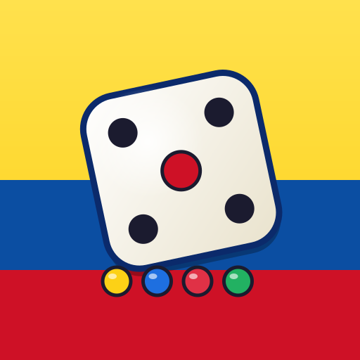
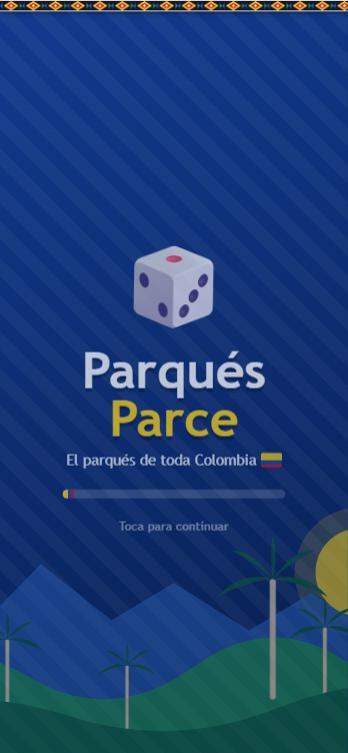
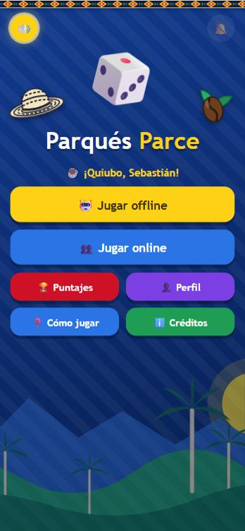
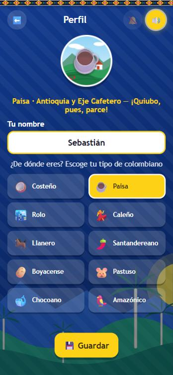
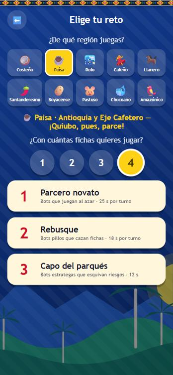
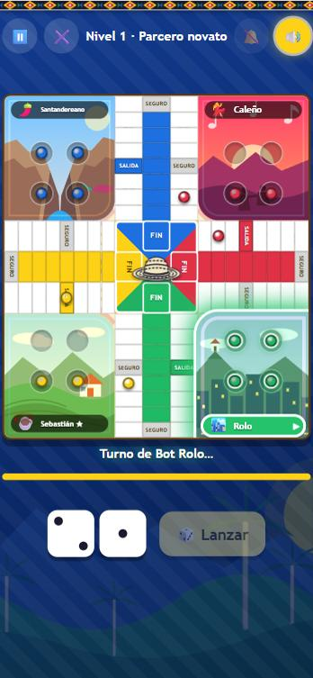
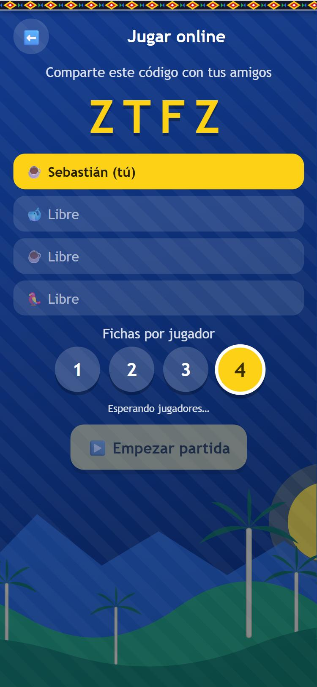
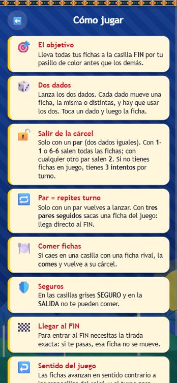
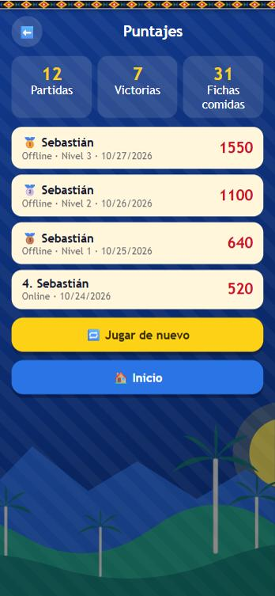
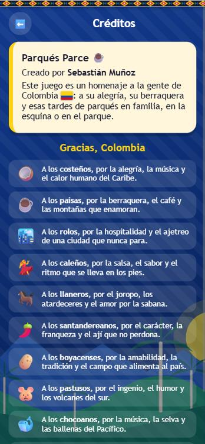

<p align="center">
  
</p>

<h1 align="center">Parqués Parce</h1>

<p align="center">
  El parqués de toda Colombia, para jugar <b>offline contra bots</b> o <b>online con amigos</b>.<br>
  Proyecto final de Aplicaciones Móviles (UPB) · Entrega #4 · Creado por <b>Sebastián Muñoz</b>
</p>

## Capturas

<table>
  <tr>
    <td align="center"><br><sub>Splash</sub></td>
    <td align="center"><br><sub>Home</sub></td>
    <td align="center"><br><sub>Perfil: tipo de colombiano</sub></td>
  </tr>
  <tr>
    <td align="center"><br><sub>Región, fichas y nivel</sub></td>
    <td align="center"><br><sub>Juego</sub></td>
    <td align="center"><br><sub>Sala online</sub></td>
  </tr>
  <tr>
    <td align="center"><br><sub>Cómo jugar</sub></td>
    <td align="center"><br><sub>Puntajes</sub></td>
    <td align="center"><br><sub>Créditos</sub></td>
  </tr>
</table>

## Qué tiene

- **Tablero de parqués** en cruz, con dos dados, SALIDA, SEGUROS, pasillo y casilla FIN para cada jugador.
- **Offline** contra 3 bots en 3 niveles (cada uno con tiempo por turno) y **online** con Firebase para 2 a 4 personas, sin bots.
- **Perfil** con 10 tipos de colombianos (costeño, paisa, rolo, caleño, llanero, santandereano, boyacense, pastuso, chocoano y amazónico). Su emoji es tu personaje y la escena de su región es el fondo de tu esquina.
- Elegir de **1 a 4 fichas** por jugador, **pausa** en el modo offline y turno resaltado con el color del jugador.
- Animaciones, sonidos y música de fondo (cambia a una más urbana mientras se juega). Se juega en **vertical**.
- **Easter eggs:** 7 toques al logo del Home (fiesta vallenata) · 5 toques al ☕ de Créditos · el nombre "Juan Valdez" · un doble seis.

## Cómo cumple el enunciado

| Requisito | Dónde |
|---|---|
| 5 secciones (Splash, Home, Juego, Puntaje, Créditos) | `www/index.html` (además: Perfil, Niveles, Sala online y Cómo jugar) |
| Mínimo 3 niveles | 3 niveles de bots con tiempo por turno (`LEVELS` en `www/js/app.js`) |
| UI personalizada | `www/css/style.css` y las ilustraciones de `www/assets/img` |
| Persistencia entre vistas | `www/js/store.js` (nombre, tipo de colombiano, ajustes, puntajes y estadísticas) |
| Animaciones y sonidos | CSS (dado, fichas, confeti, brillo del turno) y `www/js/audio.js` (WebAudio) |
| Se puede usar IA, justificándola | Ver [Créditos técnicos](#créditos-técnicos) |
| Bonus: easter eggs | Ver arriba |
| Bonus: multijugador online con Firebase | `www/js/online.js` |
| Publicación en Google Play | Proyecto Android en `android/` (ver [APK](#probar-con-el-apk-en-el-celular)) |

## Reglas del juego

- De 1 a 4 fichas por jugador (se elige al empezar) y **dos dados**. Cada dado se juega por separado con una ficha, y hay que usar los dos.
- **De la cárcel se sale con un par** (los dos dados iguales), a la casilla SALIDA: con **1-1 o 6-6 salen todas** las fichas de la cárcel y con cualquier otro par (2-2, 3-3, 4-4, 5-5) salen **2**. Si no hay fichas en juego, el jugador tiene **hasta 3 intentos** por turno para sacar un par. Con un par y fichas en el tablero se puede sacar de la cárcel (tocando una ficha de la cárcel) o mover con los dados.
- **El turno se repite solo si salen dos dados iguales (par).** Capturar o llegar a la meta no lo repiten.
- **Tres pares seguidos:** el jugador saca del juego una ficha, como si hubiera llegado a la casilla FIN, y pasa el turno.
- Si caes en una casilla de otro jugador que no sea SEGURO (punta del brazo, SALIDA o el SEGURO lateral), **lo comes** y vuelve a su cárcel.
- Para entrar a la casilla FIN se necesita la tirada exacta.
- Cada jugador tiene su pasillo y su FIN en el brazo pegado a su cárcel: Caribe (amarillo, abajo-izquierda) la izquierda, Pacífico (azul, arriba-izquierda) arriba, Andina (rojo, arriba-derecha) la derecha y Amazonía (verde, abajo-derecha) abajo.
- La SALIDA está en la 5.ª casilla del brazo, en el lado de su cárcel; los SEGUROS laterales, en el lado contrario. Las fichas avanzan en **sentido contrario a las manecillas del reloj** y entran a su pasillo por la punta de su brazo.
- Empieza el jugador y el **turno pasa hacia la derecha** (en el sentido de las manecillas del reloj).
- Offline: botón ⏸️ para pausar (la partida también se pausa sola si sales de la app).
- Online: si alguien se va, su esquina queda como "Salió", sus fichas desaparecen y la partida sigue. Si se va el anfitrión, la sala se cierra.

## Probarlo en el computador

```bash
npm install
npm start        # abre http://localhost:5173
npm test         # pruebas del motor: partidas simuladas de 1 a 4 fichas, puestos libres y reglas
```

Para verlo en el celular por Wi‑Fi, abre `http://<IP-del-computador>:5173` en el navegador del teléfono (los dos en la misma red).

## Probar con el APK en el celular

Requisitos: **Android Studio** (con el SDK de Android) y un **JDK entre 17 y 22**. Las versiones nuevas de Android Studio traen Java 25, que este proyecto (Gradle 8.7) no soporta; si es tu caso, instala un JDK 17 o 21 y úsalo en `JAVA_HOME`.

**Opción A: con Android Studio (la más fácil)**

```bash
npm install
npx cap sync android     # copia la carpeta www a la app Android
npx cap open android     # abre el proyecto en Android Studio
```

En Android Studio: elige tu celular (o un emulador) y pulsa **▶ Run**.

**Opción B: generar el APK desde la terminal**

```bash
npx cap sync android
cd android
./gradlew assembleDebug          # en Windows: gradlew.bat assembleDebug
```

El APK queda en `android/app/build/outputs/apk/debug/app-debug.apk`.

**Instalarlo en el celular**

- *Con cable:* activa las **opciones de desarrollador** y la **depuración USB**, conéctalo y ejecuta `adb install -r android/app/build/outputs/apk/debug/app-debug.apk` (`adb` está en `Android/Sdk/platform-tools`).
- *Sin cable:* pasa el archivo `.apk` al celular (WhatsApp, Drive, correo), ábrelo y permite **instalar apps de origen desconocido** cuando el teléfono lo pida.

Cada vez que cambies algo en `www/`, repite `npx cap sync android` antes de volver a compilar. El modo online necesita internet.

**Para Google Play** hace falta un paquete firmado: *Build > Generate Signed Bundle / APK > Android App Bundle (.aab)* en Android Studio. Guarda el keystore en un lugar seguro (no lo subas al repositorio) y sube el `.aab` en Play Console con la ficha de la tienda, la política de privacidad y la clasificación de contenido.

## Modo online (Firebase)

El proyecto ya está configurado con el proyecto de Firebase `parques-parce` en `www/js/firebase-config.js`, y las reglas están en `database.rules.json`. Para usar tu propio proyecto:

1. Crea un proyecto en <https://console.firebase.google.com> (puedes desactivar Google Analytics).
2. En *Configuración del proyecto > Tus apps* agrega una app **Web** (`</>`) y copia el objeto `firebaseConfig`.
3. Pégalo en `www/js/firebase-config.js` (`apiKey`, `authDomain`, `databaseURL`, `projectId`, `appId`).
4. En *Compilación > Realtime Database* crea la base y, en la pestaña **Reglas**, pega el contenido de `database.rules.json` y publica (sirve para el trabajo; para producción conviene restringir el acceso con Firebase Auth).
5. Uno entra a *Jugar online > Crear sala* y comparte el código de 4 letras; los demás entran con *Unirme*. El anfitrión pulsa *Empezar partida* (mínimo 2 jugadores; los puestos libres quedan vacíos, **sin bots**).

**Probar el modo online sin Firebase:** abre `http://localhost:5173/index.html?mock` en **dos pestañas** del mismo navegador. Usan una base simulada (`www/js/firebase-mock.js`) y muestran una franja roja de "MODO DE PRUEBA". En la app normal ese archivo no hace nada.

## Estructura

```
www/                 app web (HTML, CSS y JavaScript sin frameworks)
  js/engine.js       reglas del parqués y bots (sin pantalla; es lo que prueba npm test)
  js/app.js          pantallas, tablero, turnos y animaciones
  js/online.js       salas y partidas con Firebase Realtime Database
  js/store.js        datos guardados en el teléfono
  js/audio.js        sonidos y música
android/             proyecto Android (Capacitor)
assets/              logo del juego
docs/capturas/       capturas de pantalla del README
test/                pruebas del motor
```

## Créditos técnicos

- Música del inicio: "Atlas • Colombia" de Vadim_Makes_Sound, vía Pixabay (Licencia de contenido de Pixabay). El archivo está en `www/assets/audio/musica.mp3`.
- Música de la partida (más urbana): `www/assets/audio/musica-juego.mp3`; si no existe, suena un beat de reggaetón generado por código (composición propia).
- Ilustraciones (logo, paisaje, sombrero vueltiao, grano de café, patrón de mochila y las 10 escenas de las regiones en `www/assets/img/tipos`): vectores originales del proyecto, sin material de terceros.
- **Uso de IA:** se usó Claude (Anthropic) como apoyo para generar la base del código y las ilustraciones. Sebastián Muñoz lo revisó, lo probó, lo entiende y lo adaptó; las reglas, el diseño del tablero y las decisiones de juego se definieron con su guía y se verificaron con las pruebas de `npm test`.

## Pendiente

- Wireframes en papel y en Figma, en escala de grises.
- Ficha de la tienda y publicación en Google Play.
